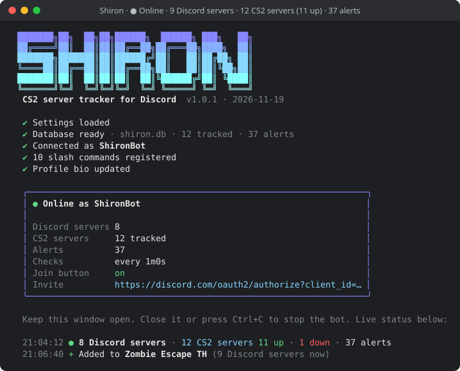

<div align="center">


# Shiron

**บอท Discord ขนาดเล็กและเร็ว สำหรับติดตามเซิร์ฟเวอร์ Counter-Strike 2**<br>
การ์ดแมพแบบสด แจ้งเตือนเมื่อเปลี่ยนแมพ และรูปแมพ ทั้งหมดอยู่ในโปรแกรมไฟล์เดียว ไม่ต้องมีเซิร์ฟเวอร์ฐานข้อมูล

[](https://github.com/Kianyaa/Shiron/stargazers)
[](go.mod)
[](LICENSE)
[](#1-สร้างแอป-discord)
[](https://github.com/Kianyaa/Shiron/commits/main)

[English](README.md) · **ภาษาไทย** · [简体中文](README.zh-CN.md)

</div>

> [!TIP]
> ถ้า Shiron มีประโยชน์กับคอมมูนิตี้ของคุณ ช่วยกด ⭐ ให้บน GitHub ด้วยนะ จะช่วยให้เจ้าของเซิร์ฟเวอร์ CS2 คนอื่นเจอโปรเจกต์นี้ได้ง่ายขึ้น

## ความสามารถ

- 🗺️ **โพสต์เมื่อเปลี่ยนแมพ** ลงในช่องแชท พร้อมรูปแมพ และตั้งจำนวนผู้เล่นขั้นต่ำได้
- 📊 **`/map` และ `/players`** ดูข้อมูลเซิร์ฟเวอร์แบบสด มีปุ่ม **เข้าเซิร์ฟเวอร์** ที่เปิด CS2 แล้วต่อเข้าเกมให้เลย
- 🔔 **แจ้งเตือน** ทาง DM หรือแท็กในช่องแชท เมื่อแมพที่อยากเล่นขึ้น ใช้ไวลด์การ์ดอย่าง `ze_*` ได้ เลือกได้ทั้งเซิร์ฟเดียวหรือทุกเซิร์ฟ
- 🟢 **โพสต์เมื่อเซิร์ฟล่ม / กลับมาออนไลน์** บอกว่าเห็นครั้งล่าสุดเมื่อไหร่ และล่มไปนานแค่ไหน
- 🖼️ **รูปแมพ** จาก Steam Workshop, คลังรูปของคอมมูนิตี้ หรือคอลเลกชัน Workshop ของคุณเอง
- 🛠️ **แผงควบคุม** แบบกดปุ่ม: `/servers list` สำหรับแอดมิน และ `/notify list` สำหรับทุกคน
- 🌏 **ไทย อังกฤษ และจีนตัวย่อ** ตามภาษา Discord ของแต่ละคน
- 🪶 **เบา**: โปรแกรมเดียว มี SQLite ในตัว ไม่ต้องใช้ privileged intents และรันบนคลาวด์ฟรีได้

<p align="center"></p>

## คำสั่ง

| คำสั่ง | ใครใช้ได้ |
|---|---|
| `/servers add ip [channel] [min_players] [style]` | สิทธิ์ Manage Server |
| `/servers list` — จัดการเซิร์ฟเวอร์ (ช่องแชท สไตล์การ์ด ผู้เล่นขั้นต่ำ ลบ) รูปแมพ และคอลเลกชัน Workshop | สิทธิ์ Manage Server |
| `/map [server]`, `/players [server]` | ทุกคน |
| `/notify add map [server]` — ไม่ใส่ `server` เพื่อรับแจ้งเตือนจากทุกเซิร์ฟ | ทุกคน |
| `/notify list` — ดู แก้ไข หรือลบการแจ้งเตือน และสลับ DM / ช่องแชท | ทุกคน |
| `/about` — เวอร์ชัน สิ่งที่เพิ่มใหม่ และสถิติ | ทุกคน |
| `/ping`, `/help`, `/invite` | ทุกคน |

การ์ดแมพมีปุ่ม: เข้าเซิร์ฟเวอร์, คัดลอก IP, ผู้เล่น, รีเฟรช และ 🔔 แจ้งเตือนฉัน

บอทตอบตามภาษา Discord ของแต่ละคน ส่วนโพสต์อัตโนมัติใช้ภาษาของเซิร์ฟเวอร์ Discord

ออกอัปเดตใหม่: เพิ่มหัวข้อแบบเดียวกับของ v1.0 (`## v1.1 · YYYY-MM-DD` ตามด้วยรายการ) ไว้ด้านบนใน [CHANGELOG.md](CHANGELOG.md) แล้ว build ใหม่ `/about` และหน้าต่างเริ่มต้นจะอ่านเวอร์ชันจากไฟล์นี้

## 1. สร้างแอป Discord

1. เปิด https://discord.com/developers/applications แล้วกด **New Application** ตั้งชื่อว่า **Shiron**
2. แท็บ **Bot**: กด **Reset Token** แล้วคัดลอกโทเคน โทเคนคือรหัสผ่านของบอท ห้ามแชร์หรือ commit เด็ดขาด
3. แท็บ **Bot**: เปิด **Public Bot** ไว้ให้ใครก็เชิญได้ และปิด **Privileged Gateway Intents** ทั้งหมด Shiron ไม่ต้องใช้

ลิงก์เชิญบอทจะแสดงตอนบอทเริ่มทำงาน และดูได้จาก `/invite`

## 2. รันบอท

ต้องมี Go 1.27 ขึ้นไป (ใช้แค่ตอน build)

ใส่โทเคนบอทในไฟล์ชื่อ `token.txt` ไว้ข้างโปรแกรม (git ไม่เก็บไฟล์นี้) จากนั้น:

```bash
go build -o shiron .
./shiron
```

บน Windows: `go build -o shiron.exe .` แล้วดับเบิลคลิก `shiron.exe` จะมีหน้าต่างแสดงเมื่อบอทออนไลน์ ปิดหน้าต่างก็คือหยุดบอท ถ้ามีปัญหา หน้าต่างจะค้างไว้และบอกว่าผิดตรงไหน

ตั้งค่าอื่นๆ ใส่ใน `shiron.conf` ข้างโปรแกรม: คัดลอก [shiron.conf.example](shiron.conf.example) แล้วแก้ไข ตัวแปรสภาพแวดล้อมจริงจะทับค่าในไฟล์

อย่าพิมพ์โทเคนลงในบรรทัดคำสั่ง (`$env:SHIRON_TOKEN = "..."`) เพราะ shell จะบันทึกไว้ในไฟล์ประวัติ

| ตัวแปร | ค่าเริ่มต้น | ความหมาย |
|---|---|---|
| `SHIRON_TOKEN_FILE` | `token.txt` | ไฟล์ที่เก็บโทเคนบอท |
| `SHIRON_TOKEN` | | โทเคนโดยตรง (ทับค่าจากไฟล์ ไม่ควรใช้บนเครื่องที่ใช้ร่วมกัน) |
| `SHIRON_DB` | `shiron.db` | ที่อยู่ไฟล์ SQLite |
| `SHIRON_POLL` | `60s` | เช็กเซิร์ฟเวอร์ทุกกี่วินาที (ขั้นต่ำ `10s`) |
| `SHIRON_CONNECT_URL` | (ปิด) | หน้าเว็บของปุ่ม **เข้าเซิร์ฟเวอร์** ดูด้านล่าง |
| `SHIRON_MAP_IMAGES` | ghostcap-gaming/cs2-map-images | URL รูปแมพที่มี `%s` หนึ่งตัวแทนชื่อแมพ หรือ `none` |

### ปุ่มเข้าเซิร์ฟเวอร์

ปุ่มใน Discord เปิดได้แค่ลิงก์ `https://` ไม่ใช่ `steam://connect` Shiron จึงลิงก์ไปที่หน้าเว็บเล็กๆ [docs/connect.html](docs/connect.html) ซึ่งจะเปิด Steam และเข้าเซิร์ฟให้

1. push repo นี้ขึ้น GitHub แล้วไปที่ **Settings → Pages** ตั้ง source เป็น branch `main` และโฟลเดอร์ `/docs`
2. ตั้ง `SHIRON_CONNECT_URL=https://<ชื่อ-github>.github.io/<ชื่อ-repo>/connect.html` (บอทหลักใช้ `https://kianyaa.github.io/Shiron/connect.html`)

ถ้าไม่ตั้ง Shiron ก็ยังแสดงคำสั่งคอนโซล `connect IP:port` ให้

### รูปแมพ

โดยค่าเริ่มต้น รูปมาจากคลังของคอมมูนิตี้ [cs2-map-images](https://github.com/ghostcap-gaming/cs2-map-images) ซึ่งมีแมพทางการอย่าง `de_dust2` ส่วนแมพคัสตอม (ZE, surf ฯลฯ) จะค้นจาก Steam Workshop และแอดมินสามารถเพิ่มคอลเลกชัน Workshop ของตัวเอง หรือตั้งรูปให้แมพไหนก็ได้ใน `/servers list` ถ้าอยากใช้ที่เก็บรูปของตัวเอง ให้วางไฟล์ PNG ตั้งชื่อตามแมพ แล้วตั้ง `SHIRON_MAP_IMAGES` เช่น `https://example.com/maps/%s.png`

เช็กเซิร์ฟเวอร์ CS2 โดยไม่ต้องใช้ Discord:

```bash
./shiron query 1.2.3.4:27015
```

## 3. ขึ้นเซิร์ฟเวอร์จริง

build สำหรับเซิร์ฟเวอร์ Linux ได้จากเครื่องไหนก็ได้ (ไม่ต้องมี C compiler):

```bash
GOOS=linux GOARCH=arm64 CGO_ENABLED=0 go build -ldflags="-s -w" -o shiron-linux-arm64 .   # Oracle Ampere, Raspberry Pi
GOOS=linux GOARCH=amd64 CGO_ENABLED=0 go build -ldflags="-s -w" -o shiron-linux-amd64 .   # VPS ทั่วไป
```

คัดลอกไฟล์ไปไว้ที่ `/opt/shiron/` บนเซิร์ฟเวอร์ สร้างผู้ใช้ `shiron` ให้เป็นเจ้าของโฟลเดอร์ แล้วบันทึกโทเคนให้ผู้ใช้นั้นอ่านได้คนเดียว:

```bash
sudo useradd --system --home /opt/shiron shiron
sudo chown -R shiron: /opt/shiron
sudo -u shiron sh -c 'umask 077; cat > /opt/shiron/token.txt'   # วางโทเคน แล้วกด Ctrl+D
```

รันด้วย systemd (`/etc/systemd/system/shiron.service`) โทเคนไม่อยู่ในไฟล์นี้ เพราะผู้ใช้ทุกคนอ่านไฟล์นี้ได้:

```ini
[Unit]
Description=Shiron Discord bot
After=network-online.target

[Service]
ExecStart=/opt/shiron/shiron
WorkingDirectory=/opt/shiron
Restart=always
User=shiron

[Install]
WantedBy=multi-user.target
```

```bash
sudo systemctl enable --now shiron
```

หรือใช้ Docker ไฟล์โทเคนจะ mount แบบอ่านอย่างเดียว แทนการส่งผ่าน `-e` ที่ `docker inspect` มองเห็นได้ คอนเทนเนอร์รันเป็นผู้ใช้ 65532 จึงต้องให้สิทธิ์ไฟล์กับผู้ใช้นั้น:

```bash
sudo chown 65532 /opt/shiron/token.txt
docker build -t shiron .
docker run -d --restart=always -v shiron-data:/data \
  -v /opt/shiron/token.txt:/run/token:ro -e SHIRON_TOKEN_FILE=/run/token shiron
```

ต้องการแค่อินเทอร์เน็ตขาออก ไม่ต้องเปิดพอร์ตใดๆ สำรองไฟล์ `shiron.db` ไว้เพื่อเก็บการตั้งค่า

## หมายเหตุ

- โปรเซสเดียวรองรับทุกเซิร์ฟเวอร์ Discord ถ้าเกิน ~2,500 เซิร์ฟ Discord บังคับให้ทำ sharding ซึ่ง Shiron ยังไม่รองรับ
- Discord ให้เจ้าของบอทยืนยันตัวตนเมื่อบอทอยู่ใน 100 เซิร์ฟ (สมัครได้ตั้งแต่ 75 เซิร์ฟ)
- [นโยบายความเป็นส่วนตัว](https://kianyaa.github.io/Shiron/privacy.html) และ [ข้อกำหนดการใช้งาน](https://kianyaa.github.io/Shiron/terms.html) อยู่บน GitHub Pages จากโฟลเดอร์ `docs/`

## ประวัติดาว

[](https://star-history.com/#Kianyaa/Shiron&Date)

## สัญญาอนุญาต

Copyright (C) 2026 Kianyaa

Shiron เป็นซอฟต์แวร์เสรีภายใต้ **GNU Affero General Public License v3.0** ([LICENSE](LICENSE)) โดยสรุป:

- ใช้ ศึกษา แก้ไข และแจกจ่ายได้
- ถ้านำ Shiron **ที่แก้ไขแล้ว** ไปให้คนอื่นใช้ (เช่น เปิดเป็นบอท Discord สาธารณะ) ต้องเปิดเผยซอร์สโค้ดที่แก้ไขภายใต้สัญญาอนุญาตเดียวกัน ถ้ารันแบบไม่แก้ไขก็ไม่ต้องทำอะไรเพิ่ม
- ไม่มีการรับประกันใดๆ

ข้อความสัญญาอนุญาตฉบับเต็ม (ภาษาอังกฤษ) คือฉบับที่มีผล สรุปนี้เป็นเพียงแนวทาง

### ชื่อและโลโก้

สัญญาอนุญาตครอบคลุมโค้ด ไม่ใช่ตัวตนของ Shiron ชื่อ **Shiron** และรูปโปรไฟล์เป็นของโปรเจกต์ ถ้าคุณเปิดเวอร์ชันที่แก้ไขให้คนทั่วไปใช้ ให้ตั้งชื่อและรูปใหม่ เพื่อไม่ให้สับสนกับบอทหลัก จะเขียนว่า "based on Shiron" พร้อมลิงก์มาที่นี่ก็ยินดี

### การร่วมพัฒนา

เมื่อส่งการแก้ไขเข้ามาในโปรเจกต์นี้ ถือว่าคุณยอมรับให้เผยแพร่ภายใต้ AGPL v3 และผู้ดูแลอาจเสนอโปรเจกต์ภายใต้เงื่อนไขสัญญาอนุญาตอื่นได้ด้วย
