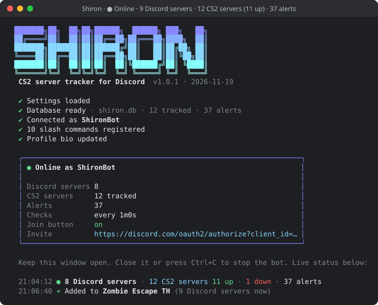

<div align="center">


# Shiron

**一个小巧快速的 Discord 机器人，用于追踪 Counter-Strike 2 服务器。**<br>
实时地图卡片、换图提醒和地图图片。只有一个程序文件，无需数据库服务器。

[](https://github.com/Kianyaa/Shiron/stargazers)
[](go.mod)
[](LICENSE)
[](#1-创建-discord-应用)
[](https://github.com/Kianyaa/Shiron/commits/main)

[English](README.md) · [ภาษาไทย](README.th.md) · **简体中文**

</div>

> [!TIP]
> 如果 Shiron 对你的社区有帮助，请在 GitHub 上点个 ⭐，让更多 CS2 服主发现它。

## 功能

- 🗺️ **换图通知**：服务器换图时在频道发帖，附地图图片，可设置最低玩家人数。
- 📊 **`/map` 和 `/players`**：查看服务器实时信息，带 **加入服务器** 按钮，一键打开 CS2 并连接。
- 🔔 **提醒**：想玩的地图出现时，通过私信或频道 @ 通知你。支持 `ze_*` 等通配符，可针对单个或全部服务器。
- 🟢 **离线 / 恢复在线通知**：显示最后在线时间和离线时长。
- 🖼️ **地图图片**：来自 Steam 创意工坊、社区图库或你自己的创意工坊合集。
- 🛠️ **按钮式控制面板**：管理员用 `/servers list`，所有人用 `/notify list`。
- 🌏 **简体中文、英语和泰语**，跟随每位用户的 Discord 语言。
- 🪶 **轻量**：单个程序，内置 SQLite，不需要特权 intents，可在免费云服务器上运行。

<p align="center"></p>

## 命令

| 命令 | 谁可以用 |
|---|---|
| `/servers add ip [channel] [min_players] [style]` | 需要“管理服务器”权限 |
| `/servers list` — 管理服务器（频道、卡片样式、最低人数、删除）、地图图片和创意工坊合集 | 需要“管理服务器”权限 |
| `/map [server]`、`/players [server]` | 所有人 |
| `/notify add map [server]` — 不填 `server` 则接收所有服务器的提醒 | 所有人 |
| `/notify list` — 查看、编辑或删除提醒，切换私信 / 频道 | 所有人 |
| `/about` — 版本、更新内容和统计 | 所有人 |
| `/ping`、`/help`、`/invite` | 所有人 |

地图卡片上的按钮：加入服务器、复制 IP、玩家、刷新和 🔔 提醒我。

回复使用每位用户的 Discord 语言，自动发帖使用 Discord 服务器的语言。

发布更新：在 [CHANGELOG.md](CHANGELOG.md) 顶部按 v1.0 的格式添加一节（标题 `## v1.1 · YYYY-MM-DD`，下面列出要点），然后重新编译。`/about` 和启动窗口会从中读取版本号。

## 1. 创建 Discord 应用

1. 打开 https://discord.com/developers/applications，点击 **New Application**，命名为 **Shiron**。
2. **Bot** 页：点击 **Reset Token** 并复制令牌。令牌就是机器人的密码：切勿分享或提交到仓库。
3. **Bot** 页：保持 **Public Bot** 开启，让任何人都能邀请。关闭所有 **Privileged Gateway Intents**，Shiron 不需要它们。

机器人启动时会显示邀请链接，`/invite` 也能看到。

## 2. 运行

需要 Go 1.27+（仅编译时需要）。

把机器人令牌放进程序旁边名为 `token.txt` 的文件（git 会忽略它），然后：

```bash
go build -o shiron .
./shiron
```

Windows：`go build -o shiron.exe .`，然后双击 `shiron.exe`。机器人上线后会显示一个窗口，关闭窗口即停止机器人。如果出错，窗口会保持打开并说明原因。

其他设置写在程序旁边的 `shiron.conf` 中：复制 [shiron.conf.example](shiron.conf.example) 后修改。真实的环境变量会覆盖文件中的值。

不要在命令行输入令牌（`$env:SHIRON_TOKEN = "..."`），shell 会把它保存到历史记录文件中。

| 变量 | 默认值 | 说明 |
|---|---|---|
| `SHIRON_TOKEN_FILE` | `token.txt` | 存放机器人令牌的文件 |
| `SHIRON_TOKEN` | | 直接填写令牌（覆盖文件；共用电脑上请勿使用） |
| `SHIRON_DB` | `shiron.db` | SQLite 文件路径 |
| `SHIRON_POLL` | `60s` | 检查服务器的间隔（最少 `10s`） |
| `SHIRON_CONNECT_URL` | （关闭） | **加入服务器** 按钮的页面，见下文 |
| `SHIRON_MAP_IMAGES` | ghostcap-gaming/cs2-map-images | 地图图片 URL，用一个 `%s` 代表地图名，或填 `none` |

### 加入服务器按钮

Discord 按钮只能打开 `https://` 链接，不能打开 `steam://connect`。所以 Shiron 会链接到一个小页面 [docs/connect.html](docs/connect.html)，由它打开 Steam 并加入服务器。

1. 把仓库推送到 GitHub，进入 **Settings → Pages**，来源选择 `main` 分支和 `/docs` 文件夹。
2. 设置 `SHIRON_CONNECT_URL=https://<你的GitHub用户名>.github.io/<仓库名>/connect.html`（官方机器人使用 `https://kianyaa.github.io/Shiron/connect.html`）。

不设置的话，Shiron 仍会显示控制台命令 `connect IP:port`。

### 地图图片

默认图片来自社区图库 [cs2-map-images](https://github.com/ghostcap-gaming/cs2-map-images)，包含 `de_dust2` 等官方地图。自定义地图（ZE、surf 等）会在 Steam 创意工坊中查找，管理员也可以在 `/servers list` 中关联自己的创意工坊合集，或为任意地图设置图片。如果想用自己的图床，把以地图名命名的 PNG 放上去，并设置 `SHIRON_MAP_IMAGES`，例如 `https://example.com/maps/%s.png`。

不通过 Discord 检查 CS2 服务器：

```bash
./shiron query 1.2.3.4:27015
```

## 3. 部署

可以在任何电脑上为 Linux 服务器编译（不需要 C 编译器）：

```bash
GOOS=linux GOARCH=arm64 CGO_ENABLED=0 go build -ldflags="-s -w" -o shiron-linux-arm64 .   # Oracle Ampere、树莓派
GOOS=linux GOARCH=amd64 CGO_ENABLED=0 go build -ldflags="-s -w" -o shiron-linux-amd64 .   # 大多数 VPS
```

把文件复制到服务器的 `/opt/shiron/`。创建拥有该文件夹的 `shiron` 用户，并保存令牌，使只有该用户能读取：

```bash
sudo useradd --system --home /opt/shiron shiron
sudo chown -R shiron: /opt/shiron
sudo -u shiron sh -c 'umask 077; cat > /opt/shiron/token.txt'   # 粘贴令牌，然后按 Ctrl+D
```

用 systemd 运行（`/etc/systemd/system/shiron.service`）。令牌不写在这个所有用户都能读取的文件里：

```ini
[Unit]
Description=Shiron Discord bot
After=network-online.target

[Service]
ExecStart=/opt/shiron/shiron
WorkingDirectory=/opt/shiron
Restart=always
User=shiron

[Install]
WantedBy=multi-user.target
```

```bash
sudo systemctl enable --now shiron
```

或使用 Docker。令牌文件以只读方式挂载，而不是用 `-e` 传入（`docker inspect` 能看到）。容器以用户 65532 运行，所以要把文件交给该用户：

```bash
sudo chown 65532 /opt/shiron/token.txt
docker build -t shiron .
docker run -d --restart=always -v shiron-data:/data \
  -v /opt/shiron/token.txt:/run/token:ro -e SHIRON_TOKEN_FILE=/run/token shiron
```

只需要出站网络，不用开放任何端口。备份 `shiron.db` 以保留设置。

## 说明

- 一个进程服务所有 Discord 服务器。超过约 2,500 个服务器时 Discord 要求分片（sharding），Shiron 目前还不支持。
- 机器人加入 100 个服务器后，Discord 要求开发者验证身份（75 个时即可申请）。
- [隐私政策](https://kianyaa.github.io/Shiron/privacy.html) 和 [服务条款](https://kianyaa.github.io/Shiron/terms.html) 由 GitHub Pages 从 `docs/` 文件夹提供。

## Star 历史

[](https://star-history.com/#Kianyaa/Shiron&Date)

## 许可证

Copyright (C) 2026 Kianyaa

Shiron 是自由软件，采用 **GNU Affero General Public License v3.0**（[LICENSE](LICENSE)）。简而言之：

- 你可以使用、学习、修改和分享。
- 如果你把**修改过的** Shiron 提供给他人使用（例如作为公开的 Discord 机器人），必须以相同许可证向他们公开修改后的源代码。原样运行则无需额外操作。
- 不提供任何担保。

以完整的许可证文本（英文）为准，本摘要仅供参考。

### 名称和标志

许可证涵盖代码，不包括 Shiron 的身份。名称 **Shiron** 和头像归本项目所有。如果你公开运行修改版，请使用不同的名称和头像，以免与官方机器人混淆。欢迎注明“based on Shiron”并附上本仓库链接。

### 贡献

向本项目提交修改，即表示你同意以 AGPL v3 发布，并同意维护者也可以按其他许可条款提供本项目。
